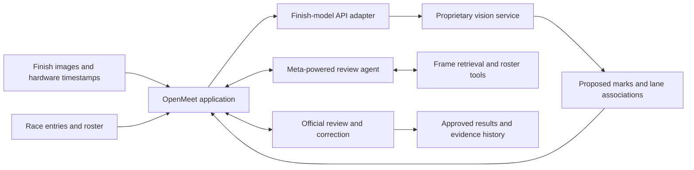

# Planned architecture

This document describes the target design. These components are not implemented yet.

## Component boundaries

### OpenMeet application

Open-source application code will manage race context, evidence, API integration, review, and results. It should make the next required operator action clear and retain access to the original finish evidence.

### Proprietary finish-model service

The custom vision model will be built as a separate service. The public application sends an inference request and receives proposed marks. Model weights stay on the service infrastructure.

The service should return its model version, request identifier, and available confidence information so a suggestion can be traced to its source. See the [draft contract](finish-model-api.md).

### Meta-powered agent

The agent helps with distance-runner identification by retrieving relevant frames, examining bib text, checking roster entries, and bringing evidence into the official's review. Its suggestions must be distinguishable from confirmed identities.

Bib evidence, the roster, and race context are the intended identification inputs. A candidate match remains unresolved when evidence is insufficient.

### Official authority

An official can inspect, adjust, confirm, or reject suggestions. Agent output and model responses cannot directly grant official approval. Review history should preserve the original proposal and subsequent decisions.

Hardware timestamps remain the authoritative timing source. Finish marks select positions within that recorded evidence; identity reconciliation changes the athlete associated with a finish.

## Failure handling

- API unavailability must be visible and preserve access to manual review.
- Invalid or incomplete responses must remain unconfirmed.
- Retries must not create duplicate finish records or approvals.
- Evidence references must point to the actual source images used in review.

## Repository and service licensing

This repository contains the MIT-licensed application and integration work. The proprietary model service, its weights, training implementation, and training data are separate materials and are not shipped here.
